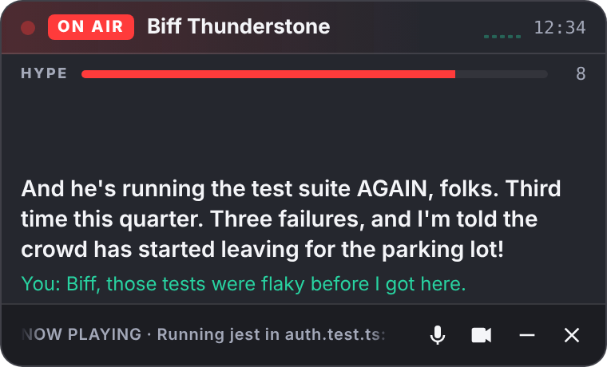

# Commentator

A live sports commentator for your coding sessions. It sits in the corner of your screen like a broadcast booth, watches you work, and calls the action: play-by-play, color commentary, made-up stats, and more sass than you asked for. Talk back and it banters.

> "And he's running the test suite AGAIN, folks. Third time this quarter. Three failures, and I'm told the crowd has started leaving for the parking lot!"



## How it works

```
 ┌──────────────── Electron main process (holds the API key) ────────────────┐
 │                                                                           │
 │  screen ──► local change detection ──► Spotter (vision model, Responses)  │
 │  every 4s    (64x36 fingerprint, free)     "what's happening + an angle"  │
 │                                                     │                     │
 │                                                     ▼                     │
 │                                 Director: pacing, cooldowns, banter-aware │
 │                                  │ speak?  session.commentary.append      │
 │                                  │ hold?   session.thinking.append        │
 └──────────────────────────────────┼────────────────────────────────────────┘
                                    │ IPC
 ┌──────────── overlay renderer ────▼────────────────────────────────────────┐
 │  WebRTC ◄──── audio both ways (your mic in, commentator voice out) ────►  │
 │  data channel "oai-events": cues/context out; transcripts and             │
 │  delegations in                                                GPT-Live 1 │
 └───────────────────────────────────────────────────────────────────────────┘
```

- **GPT-Live 1 (`gpt-live-1`) is the voice and ears.** It is OpenAI's full-duplex voice model, so speech-to-text, text-to-speech, interruptions and back-and-forth banter all happen in one WebRTC session. The live transcripts (`session.input_transcript.delta` / `session.output_transcript.delta`) drive the captions.
- **The spotter is the eyes.** GPT-Live does not accept images, so a vision-capable Responses model (default `gpt-5.4-mini`) reads screenshots and returns structured notes: what's on screen, what changed, how hype-worthy it is (0 to 10), whether it's private, and a comedic angle.
- **The director decides when to talk.** It samples the screen locally for free and only pays for a vision call when the screen actually changed (or has been frozen long enough to roast). Interesting moments go to GPT-Live as `session.commentary.append` (say this on air); dull ones go as `session.thinking.append` (silent context, so banter stays accurate). It won't talk over you, it backs off while you're bantering, and it keeps a minimum gap between unprompted calls. Big moments get through sooner.
- **Ask it things.** "What do you think of this function?" makes GPT-Live delegate (`session.delegation.created`, client delegation). The director grabs a fresh screenshot, has the spotter answer your question, and replies on the same `delegation_id`. GPT-Live stalls in character ("let's go to the replay...") while it waits.
- **Long sessions survive.** When a GPT-Live session expires or drops, the overlay reconnects and reseeds the new session with the recent conversation.

## Setup

Requirements: Node 20.12+, an OpenAI API key with GPT-Live access, and macOS, Windows or Linux (X11).

```bash
npm install
```

```bash
cp .env.example .env
```

Put your key in `.env` (`OPENAI_API_KEY=...`), and optionally pick a persona and a spice level. Then:

```bash
npm start
```

### Permissions

- **macOS:** grant **Screen Recording** and **Microphone** to the app (to Electron when running from source) in System Settings → Privacy & Security, then restart it. The overlay hides itself from screen capture, so the commentator never commentates on its own captions.
- **Windows:** the mic prompt appears on first run. The overlay is also hidden from capture.
- **Linux:** works on X11. Wayland screen capture depends on your desktop's portal. The overlay can't be hidden from capture here, so it is masked out of change detection instead.

No microphone? It still works in listen-only mode: commentary, but no banter.

## Using it

| Action | Hotkey | Overlay button |
| --- | --- | --- |
| Mute or unmute your mic | `Ctrl/Cmd+Alt+M` | mic |
| Pause screen watching (privacy) | `Ctrl/Cmd+Alt+P` | camera |
| Hide or show the overlay | `Ctrl/Cmd+Alt+H` | — |
| End the broadcast | `Ctrl/Cmd+Alt+Q` | ✕ |

Drag the overlay by its header.

**Talk to it.** It's always listening while the mic is on, so muttering at your code counts. You can:
- Banter: "Biff, that was a great refactor and you know it."
- Ask about the screen: "Can you see this error?" or "Rate my code."
- Shut it up: "shut up", "be quiet" or "not now" buys 5 minutes of silence. Say "you can talk again" to bring it back.

### The booth

| `COMMENTATOR_PERSONA` | Who | Voice |
| --- | --- | --- |
| `biff` (default) | **Biff Thunderstone.** A veteran play-by-play man with forty years in the booth and zero years writing code | `ash` |
| `nigel` | **Nigel Fairway.** A hushed golf commentator who has seen things ("and he has chosen, rather boldly, to deploy on a Friday") | `ballad` |
| `coach` | **Coach Gravel.** An old-school coach who thinks the IDE is for the weak, and gives a mean halftime speech when you're struggling | `cedar` |
| `dee` | **Dee "Null" Bugatti.** A deadpan ex-10x engineer who actually reads your code, then twists the knife | `marin` |

`COMMENTATOR_SPICE`: `1` is friendly ribbing, `2` is sarcastic (the default), `3` is a full roast. At every level it roasts the work, never the person. If you've been stuck for a while, it switches to underdog comeback-story mode.

## Configuration

Everything is set through environment variables or `.env`. See [`.env.example`](.env.example) for the full list. These matter most:

| Variable | Default | What it does |
| --- | --- | --- |
| `COMMENTATOR_USER_NAME` | — | What it calls you on air |
| `COMMENTATOR_VOICE` | persona's voice | Any GPT-Live built-in voice |
| `COMMENTATOR_VISION_MODEL` | `gpt-5.4-mini` | Any vision-capable Responses model |
| `COMMENTATOR_MIN_GAP_MS` | `20000` | Minimum time between unprompted calls |
| `COMMENTATOR_INTEREST_THRESHOLD` | `5` | How notable (0 to 10) a moment must be to call |
| `COMMENTATOR_MIN_ANALYSIS_GAP_MS` | `8000` | Minimum time between vision calls |
| `COMMENTATOR_IDLE_ROAST_MS` | `120000` | How long a frozen screen goes before it gets called out |
| `COMMENTATOR_DISPLAY` | `cursor` | Watch the display under your mouse, or `primary` |

## Cost and privacy

- **GPT-Live** is billed per second of session time. At launch it was listed at $0.05/minute (about $3 an hour), so check current pricing. Quitting the overlay closes the session.
- **Vision calls** only happen when the screen meaningfully changes, at most once per `COMMENTATOR_MIN_ANALYSIS_GAP_MS`. To spend less, raise that gap, set `COMMENTATOR_IMAGE_DETAIL=low`, or use a smaller vision model.
- **What leaves your machine:** screenshots of the watched display go to the vision model (with `store: false`), and your mic audio goes to GPT-Live while the mic is on. Nothing is written to disk.
- The spotter flags screens that show secrets, private messages or personal information. When it does, the commentator gets only "something private is on screen". That check is best effort, so **pause screen watching (`Ctrl/Cmd+Alt+P`) before opening a password manager or anything sensitive.** Muting the mic disables the track locally, so no audio is sent.

## Development

```bash
npm test
```

```bash
npm run spot -- path/to/screenshot.png
```

```bash
npm run spot -- path/to/screenshot.png --ask "what do you think of this function?"
```

`npm run spot` runs the spotter on a single screenshot without launching the overlay. Use it to tune prompts and check latency.

```
src/
  main/
    main.js          Electron entry: overlay window, IPC, hotkeys, permissions
    director.js      pacing policy: when to analyze, when to speak, delegations, quiet mode
    spotter.js       vision model calls (Responses API, structured outputs)
    prompts.js       GPT-Live persona instructions, spotter prompts, cue formatting
    live-session.js  POST /v1/live/sessions (SDP exchange) with session config
    screen.js        desktop capture and fingerprinting
    config.js        env / .env loading
  renderer/          the overlay: WebRTC to GPT-Live, captions, hype meter, controls
  shared/            personas, frame diffing, transcript grouping (no Electron deps)
scripts/spot.js      spotter CLI
test/                node:test unit tests for the director and shared modules
```

The GPT-Live integration targets the Live API as typed in `openai` 7.51.
